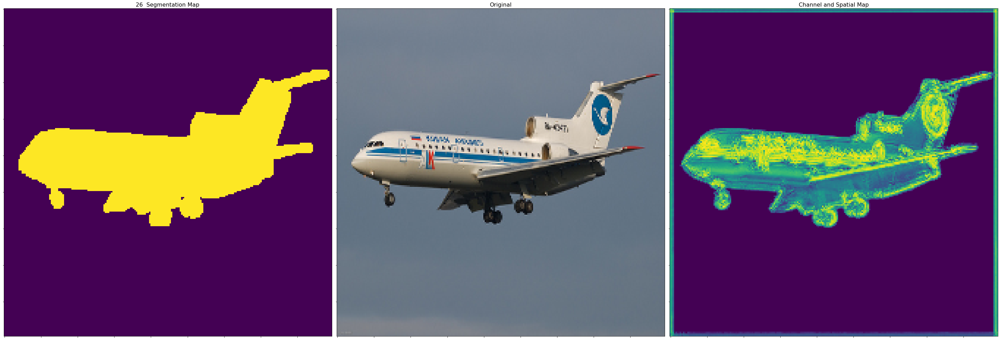
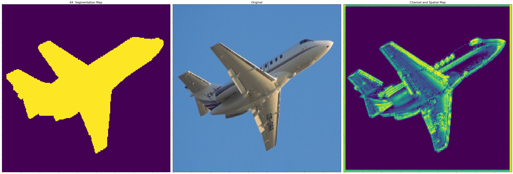
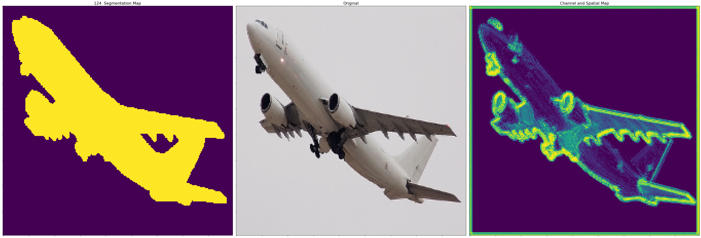
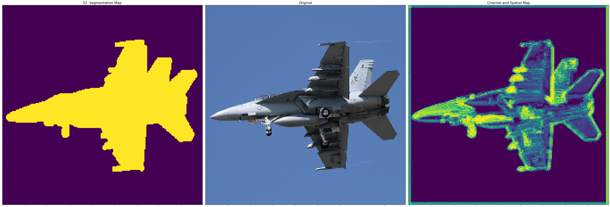
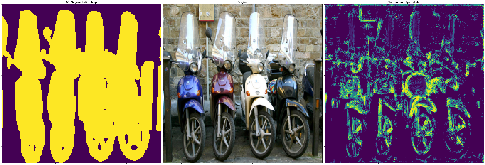
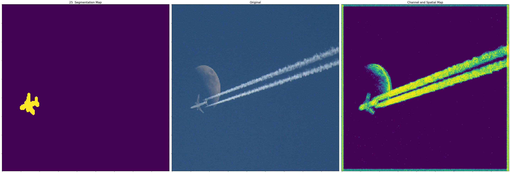
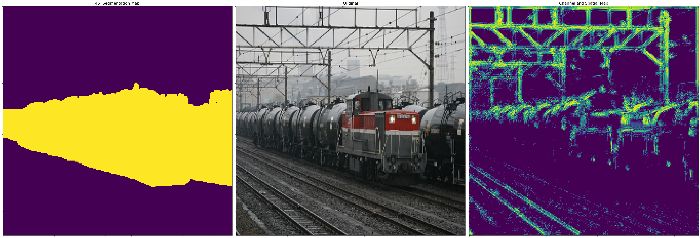
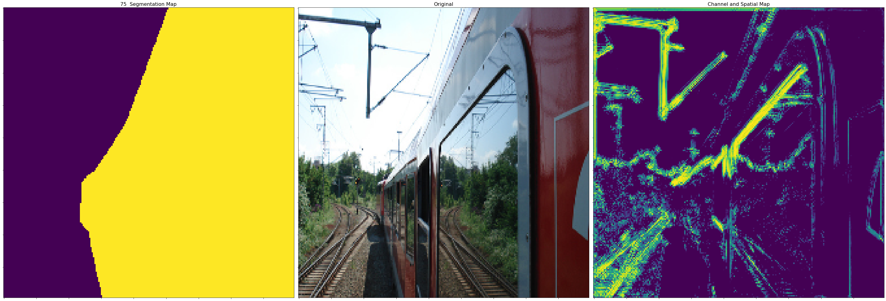
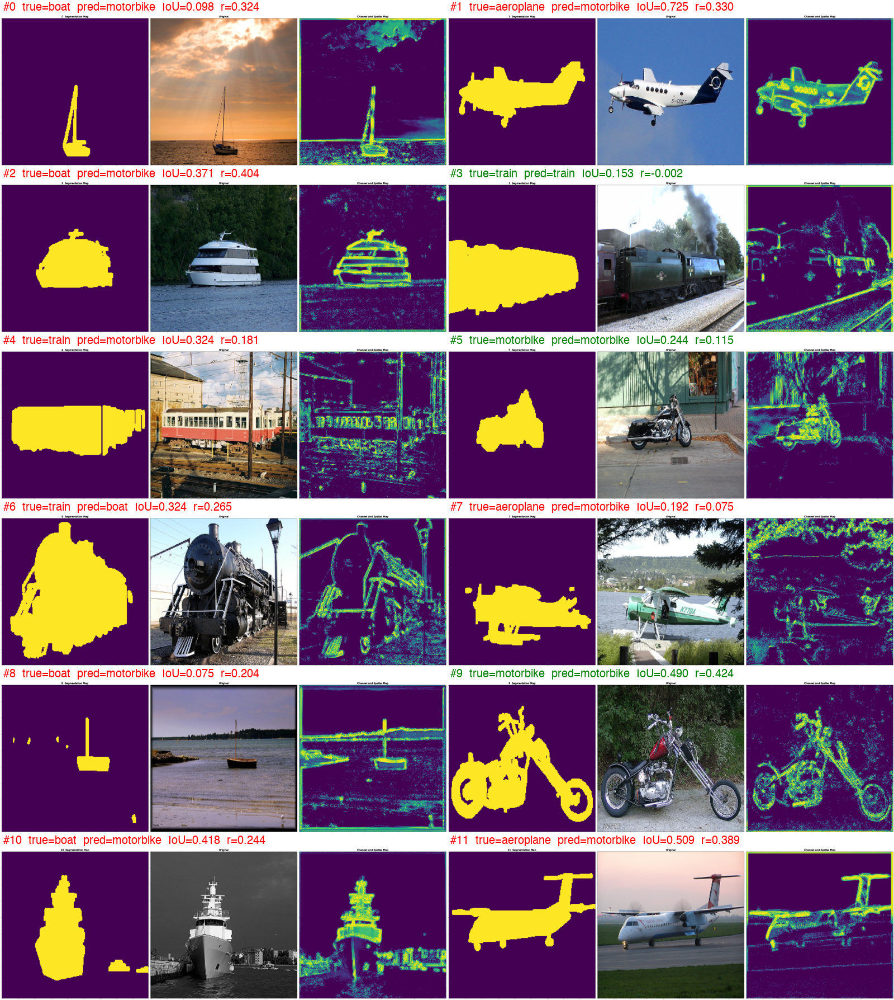
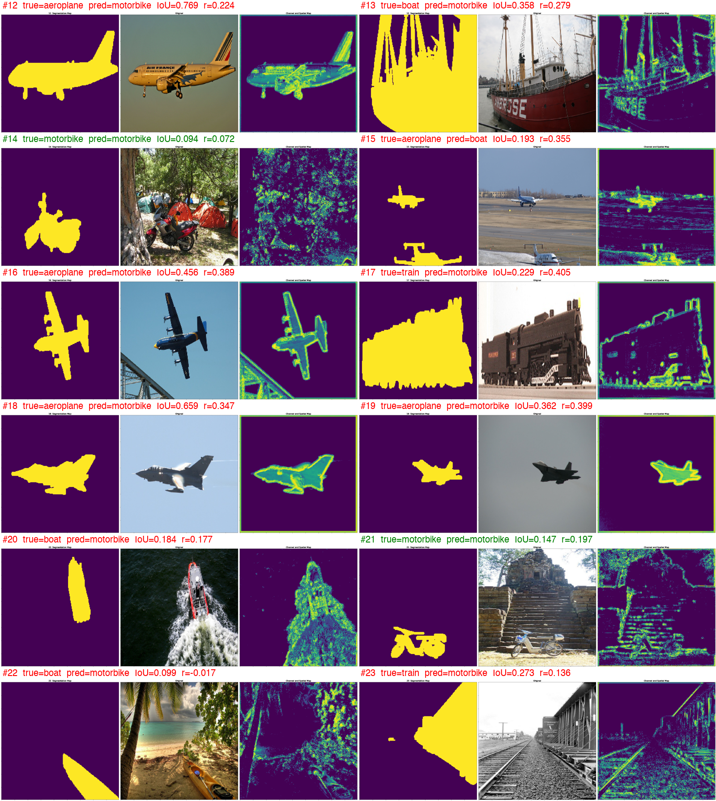

# Do CNN Attention Maps Match Object Segmentations?
### Evaluating CBAM attention against Pascal VOC segmentation masks

## Overview
This master's project studies the **interpretability** of convolutional networks. A ResNet-18 with **CBAM (Convolutional Block Attention Module)** layers is trained as an **image classifier**, using image-level labels only. Its learned attention maps are then compared with **ground-truth segmentation masks** from Pascal VOC 2012.

**Research question:** if a network is only told *what* is in an image, does its attention learn *where* the object is?

Many published comparisons show a few hand-picked attention images. This project evaluates the alignment **quantitatively on every validation image** (133 images) using IoU, Pearson correlation, MAE and SSIM.

## Segmentation vs. attention

| | Segmentation mask | CBAM attention map |
|---|---|---|
| Source | Human annotation | Learned by the network |
| Values | Discrete (object / background) | Continuous (0–1) |
| Purpose | Mark the full object | Amplify features useful for classification |
| Covers | Whole object, including plain interiors | Mostly edges, textures and parts that tell classes apart |
| Context | Never includes background | May include useful background (water, rails) |
| Supervision | It *is* the label | Learned without any location labels |

Segmentation answers **"where is the object?"** Attention answers **"where is the evidence?"** This project measures how much the two overlap.

## How CBAM works
- **Channel attention (what):** each channel is reduced by average pooling and max pooling, passed through a shared MLP and a sigmoid. The result is one weight per feature channel.
- **Spatial attention (where):** the max and mean are taken across channels, then a convolution and a sigmoid give one weight per pixel.
- **Output:** `features × channel_weights × spatial_weights`, plus the residual skip connection.
- **Learning:** there is no attention label. The gates are trained end to end by the cross-entropy loss, so attention moves toward regions that help the classification.

## Method
1. **Data:** Pascal VOC 2012 with 4 classes (aeroplane, boat, motorbike, train) at 224×224. 900 training and 225 validation images.
2. **Model:** ResNet-18 with a CBAM module in each of its 8 residual blocks. CBAM is adapted from the [official implementation](https://github.com/Jongchan/attention-module) to also return its attention maps.
3. **Training:** cross-entropy loss, Adam (learning rate 1e-4, weight decay 1e-4), PyTorch Lightning.
4. **Evaluation:** for each validation image with a segmentation mask:
   - resize the combined channel × spatial attention map to 224×224
   - binarize both the mask and the attention at their median, then compute **IoU** and **Dice**
   - compute **Pearson correlation**, **MAE** and **SSIM** on the continuous maps

## Results

**Classification:** 92.4% validation accuracy (loss 0.25).

**Alignment between attention and segmentation (layer 0, 133 images):**

| Metric | Value |
|---|---|
| Mean IoU | **0.31** (median 0.30, max 0.77) |
| Images with IoU > 0.5 | 17 / 133 |
| Mean Pearson correlation | **0.22** |
| Images with positive correlation | **129 / 133 (97%)** |
| Correlation between IoU and r across images | 0.54 |
| Mean MAE | 0.27 |
| Mean SSIM | 0.04 |

**By class:**

| Class | Images | Mean IoU | Best IoU | Mean r |
|---|---|---|---|---|
| Aeroplane | 46 | **0.40** | 0.77 | 0.28 |
| Motorbike | 22 | 0.29 | 0.55 | 0.21 |
| Boat | 28 | 0.28 | 0.56 | 0.21 |
| Train | 37 | 0.23 | 0.46 | 0.15 |

## Key findings
- **Attention localizes objects without any location labels.** Correlation is positive in 97% of images. On plain backgrounds (aeroplanes against sky), attention traces the full silhouette, with IoU up to 0.77.
- **Early-layer attention acts as an edge and saliency detector.** It highlights outlines, windows, wheels and text or logos, more than plain object interiors.
- **Clutter spreads attention.** Scenes with many edges (train stations, forests) dilute it, so trains score lowest.
- **Look-alike distractors fool it.** Contrails, power lines and ridge lines attract attention because they look like wings or rails to a low-level layer.
- **The network uses context.** Water and horizons are highlighted for boats.
- **Every instance is found.** Attention covers all objects in an image (for example, several scooters), not just one.
- **Localization works even when classification doesn't.** Attention aligned well even on images the model misclassified. Early attention encodes *where something is* more than *what it is*.

**In short:** attention is not segmentation. It is the network's *evidence*: mostly on the object, partly on context, and sometimes fooled by similar-looking structure.

## Example results

Each figure shows the hand-drawn segmentation (left), the original image (middle) and the CBAM attention map (right).

### Best cases: clean backgrounds
| Image 26 (IoU 0.75) | Image 84 (IoU 0.77) |
|---|---|
|  |  |

| Image 124 (IoU 0.75) | Image 52 (IoU 0.77) |
|---|---|
|  |  |

### Multiple objects found


### Failure cases
**Distracted by look-alikes:** the attention follows the contrail and the moon instead of the small plane (IoU 0.04).


**Busy scene:** wires, rails and the station light up as well as the train.


**Close-up:** the attention traces the edges correctly, but the scoring gives a near-zero IoU.


### All 133 results
Overview sheets with the true class, prediction, IoU and correlation for every image (green = correct prediction, red = wrong):




The rest are in [`results/contact_sheets/`](results/contact_sheets/), and the individual figures are in [`results/figures/`](results/figures/). Scores for every image are in [`results/scores.txt`](results/scores.txt).

## Limitations
- The median threshold caps IoU for small objects, because about half the image is always marked as "attended".
- VOC "void" boundary pixels aren't removed before comparison. For close-ups, the mask collapses to the object outline, which lowers IoU.
- Zero padding creates a bright border artifact in the attention maps.
- Dice is miscomputed because the two binary masks use different "on" values (255 vs. 1).
- The visualization pass runs without `model.eval()`, which degrades predictions with a batch size of 1.
- The spatial gate uses a 1×1 kernel (the paper uses 7×7), and the reported results are for layer 0 only.

## Future work
- Fix the evaluation issues above and re-run.
- Compare attention across all 8 layers.
- Use a 7×7 spatial kernel, as in the original paper.
- Compare against Grad-CAM and a ResNet-18 baseline without CBAM.

## Project structure
```
cbam.py      # CBAM module (channel + spatial attention), returns attention maps
resnet.py    # ResNet-18 with CBAM in each residual block
model.py     # PyTorch Lightning training module
loader.py    # Pascal VOC classification and segmentation loaders
main.py      # Training, attention visualization and metric computation
cbam_final.ipynb  # Colab notebook with full run and outputs
results/
  figures/         # 133 figures: segmentation, image, attention map (000.png … 132.png)
  contact_sheets/  # 12 overview sheets with class, prediction, IoU and correlation
  scores.txt       # per-image true class, prediction, IoU and correlation
```

## Running
```bash
pip install torch torchvision pytorch_lightning torchmetrics scikit-image scipy opencv-python
# Download Pascal VOC 2012 into ./VOCdevkit/VOC2012
python main.py
```

## References
- Woo et al., *CBAM: Convolutional Block Attention Module*, ECCV 2018. [arXiv:1807.06521](https://arxiv.org/abs/1807.06521)
- He et al., *Deep Residual Learning for Image Recognition*, CVPR 2016.
- Everingham et al., *The PASCAL Visual Object Classes Challenge 2012*.

- Full report here https://claude.ai/artifact/PHY47kujZd77T5iaquCEeP#2dd04a42-965f.m7z8wrh7vz7.17154
